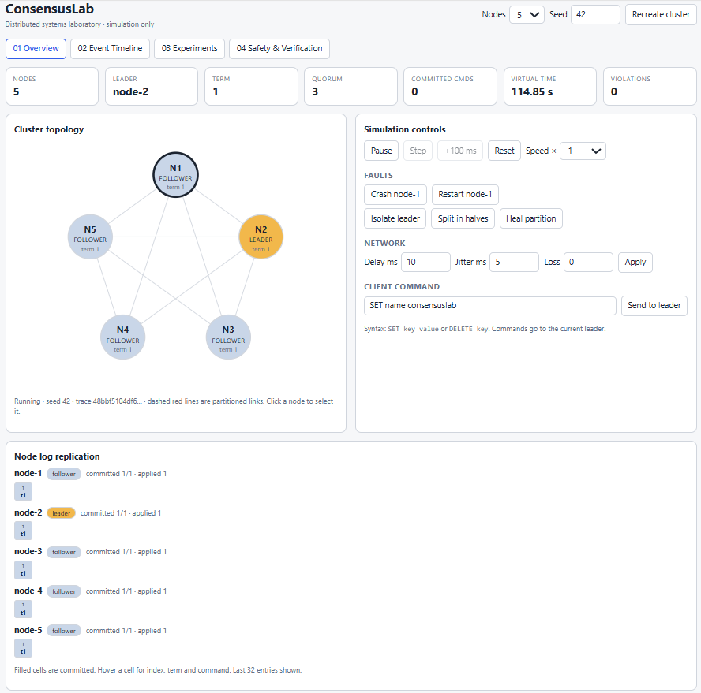
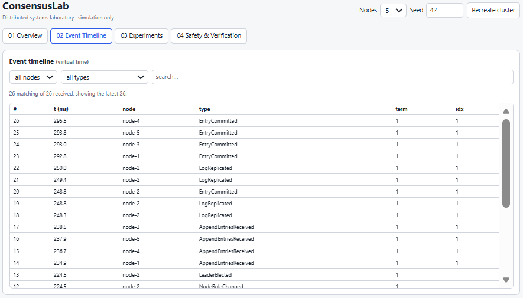
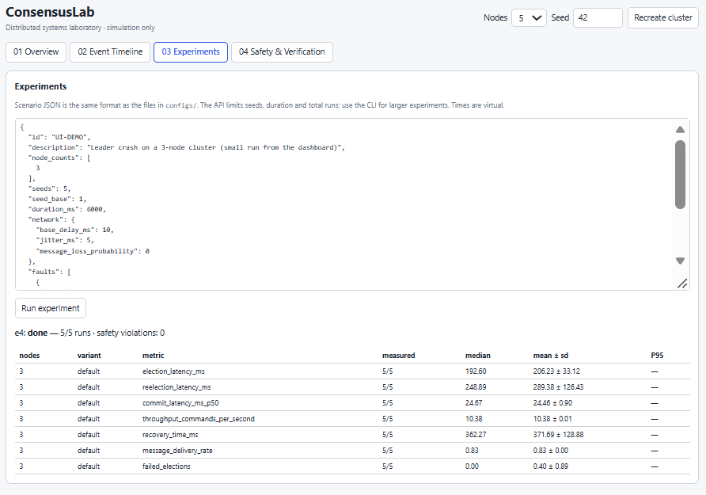
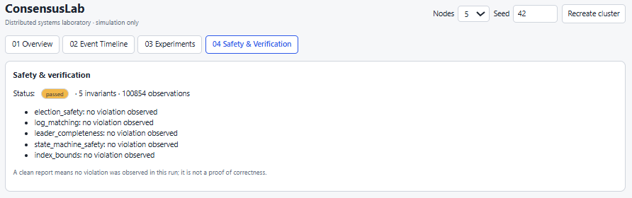
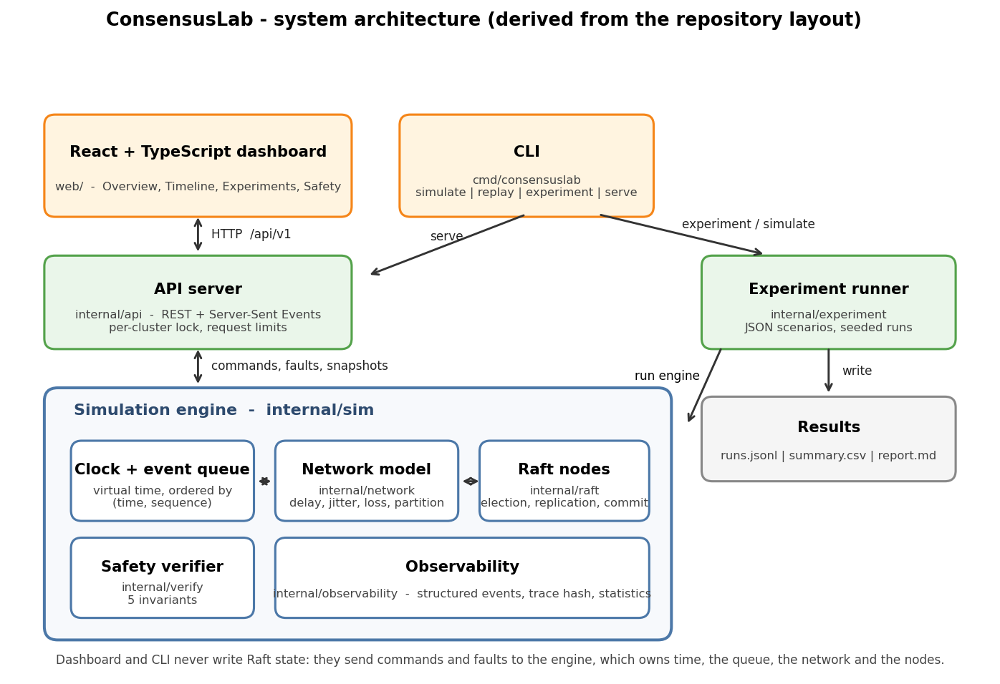
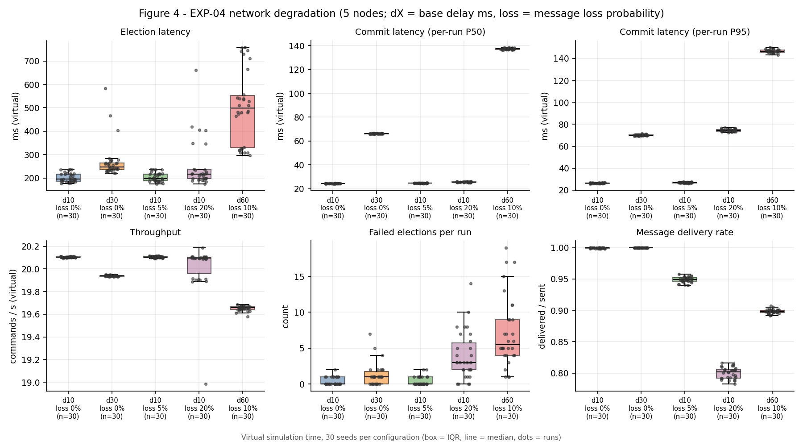
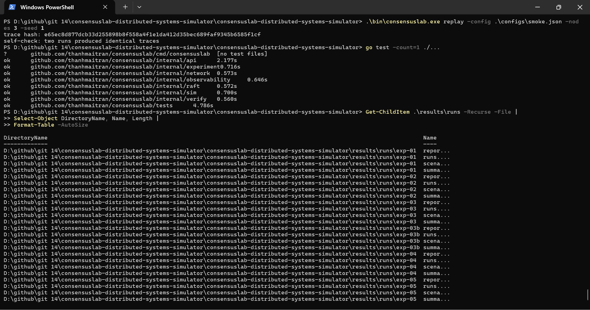

# ConsensusLab

**A Deterministic Distributed Systems Simulator
for Raft Consensus, Fault Injection,
Safety Verification and Experimental Analysis.**

[](https://github.com/thanhmaitran/consensuslab/actions/workflows/ci.yml)


## Overview

ConsensusLab is an experimental distributed-systems simulator that implements the
[Raft](https://raft.github.io/raft.pdf) consensus protocol in a controlled environment. It models
independent nodes, leader election, replicated logs, network delay, message loss, partitions and node
crashes to investigate consistency, fault tolerance and recovery behaviour.

It combines a deterministic simulation engine, a modular Raft implementation, an independent safety
verifier, reproducible experiments and an interactive dashboard. The goal is to make distributed
consensus **observable, testable and measurable** under controlled fault scenarios.

> ConsensusLab is a simulator for study and research. It is **not** a production consensus service.

### Status

| Area | State |
|---|---|
| Raft core (election, replication, commit, restart) | Implemented (fixed membership, no snapshots, no persistence to disk) |
| Deterministic engine, network faults, partitions | Implemented |
| Safety verifier (5 invariants) | Implemented |
| Unit, integration and randomized tests | `go test -count=1 ./...` passed on the author's machine ([screenshot](docs/images/terminal-tests.png)); the race detector has not been run (no CGO in that environment) |
| Experiment runner (JSON scenarios → JSONL/CSV/Markdown) | Implemented |
| REST + Server-Sent Events API | Implemented |
| React dashboard | Implemented, see `web/` and the [preview](#dashboard-preview) |
| Experimental results | **450 runs completed in 6 experiments** with 0 safety violations — see [Experimental Results](#experimental-results) and the [report](docs/experimental-report.md) |

## Key Features

- 1–7 node clusters that can be started, crashed and restarted; persistent state (term, vote, log) survives a restart, volatile state does not.
- Randomised election timeouts from a per-node seeded RNG, RequestVote, AppendEntries with fast log backtracking, leader no-op, commit only by current-term quorum.
- Virtual time: an ordered event queue drives ticks and message delivery, so a run depends only on configuration, seed and inputs.
- Network simulator: base delay, jitter, loss probability, pairwise-reachability partitions.
- Verifier: election safety, log matching, leader completeness, state-machine safety, index bounds — checked after every event that touches a node.
- Experiment runner with seeded repetitions and honest metrics (`null` means "not measured", never `0`).
- Replay: `consensuslab replay` re-runs a seed and compares trace hashes.
- Dashboard: topology, per-node logs, controls, event timeline, experiments and verification pages.

## Dashboard Preview

### Overview



### Event Timeline



### Experiments



### Safety and Verification



The screenshots show single interactive sessions (5 nodes, seed 42). The experiment in the dashboard
ran 5 seeds; it is separate from the 450 command-line runs reported below.

## System Architecture



The diagram is generated from the repository layout by `scripts/make_architecture_diagram.py`.
The same structure as plain text:

```
React + TypeScript dashboard  ──REST + SSE──►  Go API server
                                                   │ (serialised access)
                              ┌────────────────────┴────────────────────┐
                              │ Simulation engine (virtual clock, queue) │
                              │   Network ─ delay/loss/partition         │
                              │   Raft nodes (election, replication)     │
                              │   Verifier (invariants, violations)      │
                              └────────────────────┬────────────────────┘
                                     Experiment runner → JSONL / CSV / report.md
```

Details: [docs/architecture.md](docs/architecture.md), [docs/raft-protocol.md](docs/raft-protocol.md),
decisions in [docs/adr/](docs/adr/).

## Raft Implementation

Fixed-membership Raft following Figure 2 of the paper: leader election with log-freshness voting,
`AppendEntries` with conflict hints for fast backtracking, a leader no-op entry, commit only for entries of the
leader's current term, a deterministic key-value state machine and crash/restart that keeps term, vote and log.
Not implemented: snapshots, dynamic membership, pre-vote, check-quorum, disk persistence.
See [docs/raft-protocol.md](docs/raft-protocol.md).

## Simulation and Fault Models

- **Time:** virtual; the engine advances a clock from an ordered event queue. All reported times are virtual milliseconds, not wall-clock.
- **Network:** base delay + uniform jitter, independent message loss, partitions defined by reachability groups.
- **Faults:** `crash`, `crash_leader`, `restart`, `partition` (`group_sizes`, `isolate_leader`), `heal`.
- **Randomness:** per-node and network generators seeded from the run seed, so a run can be replayed exactly.

## Experimental Methodology

Six scenarios (`configs/`), 30 seeds per configuration (seeds 1–30), election timeout 150–300 ms,
heartbeat 50 ms, a fixed-interval client workload. Metrics (election latency, re-election latency,
commit latency, throughput, recovery time, failed elections, delivery rate) are defined in
[docs/experimental-report.md](docs/experimental-report.md#53-metrics-as-implemented). Experiments ran on
Windows 11, Go 1.27.3, AMD64, 8 CPUs, about 8.3 GB RAM.

## Experimental Results

| Experiment | Scenario | Configured runs | Completed | Safety violations |
|---|---|---:|---:|---:|
| EXP-01 | Baseline, 3/5/7 nodes | 90 | 90 | 0 |
| EXP-02 | Leader crash, 3/5/7 nodes | 90 | 90 | 0 |
| EXP-03 | Partition 3/2, leader in the minority | 30 | 30 | 0 |
| EXP-03B | No-quorum partition 2/2/1 | 30 | 30 | 0 |
| EXP-04 | Network degradation, 5 variants | 150 | 150 | 0 |
| EXP-05 | Node crash and restart, 3/5 nodes | 60 | 60 | 0 |
| **Total** | | **450** | **450** | **0** |

All 450 configured simulation runs completed. The verifier reported zero safety violations across these
runs. This is empirical evidence from the tested scenarios, not a formal proof of correctness. Before
analysis, every statistic in the six `summary.csv` files was recomputed from `runs.jsonl`
(728 values, 0 mismatches; [data-verification.md](results/analysis/data-verification.md)).

Selected measurements (virtual ms, median over 30 seeds; medians of per-run values for commit latency):

| Question | Measurement |
|---|---|
| Election time, no faults | 209.7 / 195.8 / 196.2 ms for 3 / 5 / 7 nodes |
| Commit latency, no faults (per-run P50) | 23.8 / 24.4 / 24.6 ms |
| Leader crash: next leader elected after | 254.0 / 219.4 / 213.3 ms; all 100 commands committed in every run |
| 3/2 partition, leader in minority: majority elects a new leader after | 195.7 ms |
| 2/2/1 partition (no quorum): first leader after the partition began | 4027.0–4288.0 ms, i.e. only after the heal at +4000 ms |
| Commit latency, per-run P95, at 20% loss vs no loss | 74.7 ms vs 26.4 ms (per-run P50: 25.5 vs 24.4 ms) |

Read these with the caveats in the report: throughput equals the offered load (12.5–20 cmd/s) and is not a
capacity measurement; `recovery_time_ms` in EXP-02 and EXP-05 is dominated by the end of the client workload
and should not be read as a recovery duration; EXP-05 mixes follower- and leader-crash runs.



See the [Experimental Report](docs/experimental-report.md) for methodology, metrics, analysis and
limitations, and `results/analysis/` for the tables and figures generated from the data.

## Safety and Verification

Five invariants are checked after every event that touches a node: election safety, log matching, leader
completeness, state-machine safety and index bounds ([details](docs/experimental-report.md#7-safety-and-verification)).
A clean report means that no violation was observed in the executed scenarios; it is not a proof of correctness.



## Technology Stack

- Go (standard library only) — simulation engine, Raft, API, CLI
- React 18, TypeScript, Vite — dashboard
- HTTP/JSON API and Server-Sent Events (SSE)
- JSON scenarios; JSONL, CSV and Markdown results
- Python with matplotlib (optional) — analysis scripts in `scripts/`

## Getting Started

### Prerequisites

- Go 1.22 or later
- Node.js 20 or later and npm (dashboard only)
- Git

### Build the dashboard

```bash
cd web
npm install
npm run build
cd ..
```

### Run the simulator and dashboard

```bash
go build -o bin/consensuslab ./cmd/consensuslab
./bin/consensuslab serve -addr :8080 -static ./web/dist
```

Open <http://localhost:8080>. In PowerShell:

```powershell
go build -o bin\consensuslab.exe .\cmd\consensuslab
.\bin\consensuslab.exe serve -addr :8080 -static .\web\dist
```

For frontend development run `consensuslab serve -addr :8080` and, in `web/`, `npm run dev`
(<http://localhost:5173>).

### Check everything

```bash
make all                       # gofmt check, vet, tests, build  (Windows: scripts/check.ps1)
```

Without `make` (PowerShell): `go vet ./...; go test ./...; go build -o bin/consensuslab.exe ./cmd/consensuslab`.

## Usage

```bash
consensuslab simulate   -config FILE [-nodes N] [-variant NAME] [-seed S] [-events FILE]
consensuslab replay     -config FILE -nodes N [-variant NAME] -seed S [-expect TRACE_HASH]
consensuslab experiment -config FILE -out DIR [-workers N]
consensuslab serve      [-addr :8080] [-origin URL]... [-static DIR]
consensuslab version
```

Quick check and replay:

```bash
bin/consensuslab simulate -config configs/smoke.json -nodes 3 -seed 1
bin/consensuslab replay   -config configs/smoke.json -nodes 3 -seed 1
```

### Configuration

Scenarios are JSON files in `configs/` (unknown fields are rejected):

```json
{
  "id": "EXP-02",
  "node_counts": [3, 5, 7],
  "seeds": 30,
  "duration_ms": 10000,
  "election_timeout_ms": [150, 300],
  "heartbeat_ms": 50,
  "network": { "base_delay_ms": 10, "jitter_ms": 5, "message_loss_probability": 0 },
  "faults": [{ "at_ms": 3000, "type": "crash_leader" }],
  "workload": { "commands": 100, "start_ms": 2000, "interval_ms": 50 }
}
```

Fault types: `crash`, `crash_leader`, `restart`, `partition` (`group_sizes`, `isolate_leader`), `heal`.
Shipped scenarios: `exp-01` baseline, `exp-02` leader crash, `exp-03`/`03b` partitions, `exp-04` network
degradation, `exp-05` restart and recovery, `smoke` for quick checks.

### Experiments

```bash
bin/consensuslab experiment -config configs/exp-02-leader-crash.json -out results/runs/exp-02 -workers 4
python scripts/analyze_results.py        # verify, summarise and plot results/runs/*
```

Each experiment writes `runs.jsonl` (one record per seed, with trace hash), `summary.csv` (mean, std dev,
median, min, max, P95/P99 when enough samples, 95% CI), `report.md` and, if an invariant failed,
`failures/*.json` with everything needed to replay. Metric definitions: [docs/experiments.md](docs/experiments.md).

### Testing

```bash
go test ./...          # unit + integration (tests/INT-01…INT-12) + randomized scenarios
go test -race ./...    # race detector (needs CGO; the engine is single-threaded, the API is not)
go test -short ./...   # fewer random seeds
```

Strategy and replay of failures: [docs/testing.md](docs/testing.md).

### API

Prefix `/api/v1`: `POST /clusters`, `GET /clusters/{id}`, `POST /clusters/{id}/{start|pause|step}`,
`POST /clusters/{id}/nodes/{nodeId}/{crash|restart}`, `POST|DELETE /clusters/{id}/partitions[/{pid}]`,
`POST /clusters/{id}/commands`, `POST /clusters/{id}/network`, `GET /clusters/{id}/events`,
`GET /clusters/{id}/stream` (SSE), `GET /clusters/{id}/report`, `POST /experiments`, `GET /experiments/{id}`.
Clients never set `currentTerm` or `commitIndex`; they can only issue commands and faults.
The **Nodes** selector in the dashboard takes effect when a cluster is (re)created with **Create / Recreate cluster**.

## Project Structure

```
cmd/consensuslab/        CLI entry point (simulate, replay, experiment, serve, version)
internal/raft/           Raft node, messages, key-value state machine
internal/sim/            virtual clock, event queue, engine, faults, metrics
internal/network/        delay, jitter, loss, partitions
internal/verify/         safety invariants and violation reports
internal/observability/  structured events, trace hash, statistics
internal/experiment/     scenario loading, runner, aggregation, reports
internal/api/            REST + SSE server
web/                     React + TypeScript dashboard (Vite)
configs/                 experiment scenarios (JSON)
tests/                   integration (INT-01…12) and randomized scenario tests
results/runs/            raw outputs of the 450 runs (runs.jsonl, summary.csv, report.md, scenario.json)
results/analysis/        verification, comparison tables and figures generated from the runs
results/local-validation/ replay and smoke-run logs
docs/                    architecture, protocol, testing, experiments, limitations, ADRs, report
docs/images/, figures/   screenshots, architecture diagram, report figures
scripts/                 check.ps1, analyze.py, analyze_results.py, make_architecture_diagram.py
```

## Limitations

- Fixed cluster membership.
- No log snapshotting or compaction.
- No persistent disk storage (state survives a simulated restart only in memory).
- No pre-vote and no check-quorum.
- Simulation results depend on configured scenarios, network models and random seeds.
- The simulation does not establish real-world distributed deployment performance; times are virtual.

More in [docs/limitations.md](docs/limitations.md) and §9 of the [report](docs/experimental-report.md#9-limitations-and-future-work).

## Future Work

Re-measure recovery time with a quiet period after the fault; pre-vote and check-quorum; disk persistence and
snapshotting; dynamic membership; higher offered load for throughput; more adversarial faults; a TLA+ model;
a process-based cluster mode; comparison with another consensus implementation.

## Documentation

- [Experimental Report](docs/experimental-report.md)
- [Architecture](docs/architecture.md), [Raft protocol](docs/raft-protocol.md), [Testing](docs/testing.md), [Experiments](docs/experiments.md), [Limitations](docs/limitations.md)
- [Architecture decision records](docs/adr/)
- [Project configurations](configs/)
- [Experiment results](results/runs/) and [analysis](results/analysis/)

## References

1. D. Ongaro, J. Ousterhout. *In Search of an Understandable Consensus Algorithm.* USENIX ATC 2014. <https://raft.github.io/raft.pdf>
2. Raft project site and TLA+ specification: <https://raft.github.io/>

## License

MIT — see [LICENSE](LICENSE).
