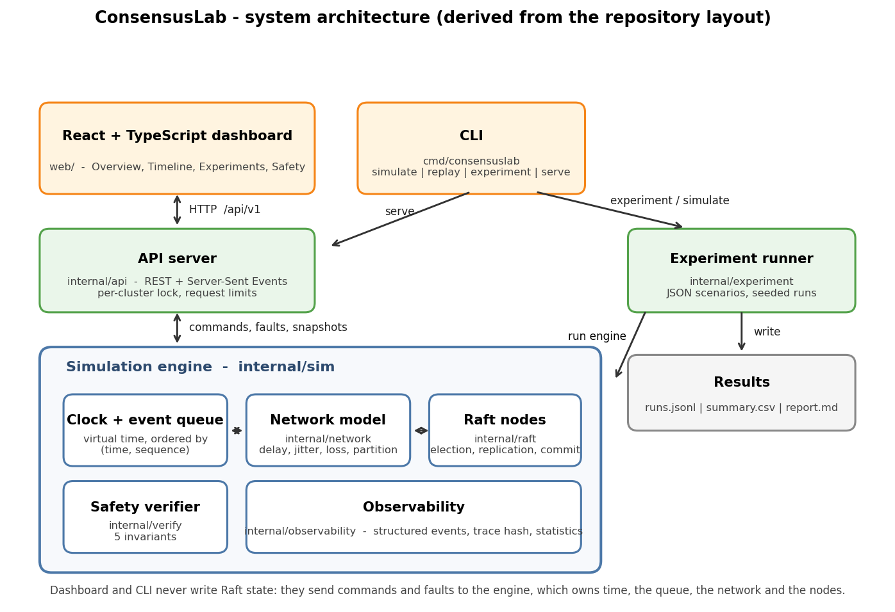

# Architecture



The diagram is generated from the repository layout by `scripts/make_architecture_diagram.py`.

## Components

| Package | Responsibility | Must not |
|---|---|---|
| `internal/raft` | Protocol logic of one node: roles, terms, votes, log, commit, state machine | open sockets, read the clock, pick random delays for the network |
| `internal/network` | Decides delay, loss and reachability of each message; counts outcomes | touch Raft state |
| `internal/sim` | Virtual clock, ordered event queue, node lifecycle, fault events, client commands, metrics | contain protocol rules |
| `internal/verify` | Independent safety checks over node snapshots | change node state |
| `internal/observability` | Event schema, bounded recorder, trace hash, statistics | know about Raft internals |
| `internal/experiment` | Scenario files, seeded runs, aggregation, JSONL/CSV/Markdown output | bypass the engine |
| `internal/api` | REST + SSE, request validation, per-cluster locking, limits | let clients write Raft state |
| `web/` | Dashboard | depend on private Raft structures |

## State ownership

* A `raft.Server` owns its persistent state (`currentTerm`, `votedFor`, `log`) and volatile state.
* The engine owns time, the queue, the network and the node lifecycle. All calls into nodes happen on one goroutine.
* The API serialises access to each engine with a per-cluster mutex. The frontend only receives read-only snapshots (`NodeView`) and event JSON.

## Message flow

```
Node.Tick / HandleMessage
   └─ env.Send(msg) ──► Engine.Send ──► Network.Route (delay | drop)
                                           └─ Event{DeliverMessage, At=now+delay}
Engine.Step: pop earliest event ─► process ─► Verifier.ObserveNode(touched node)
```

Equal timestamps are ordered by a monotonically increasing sequence number, so the order is total and deterministic.

## Event model

Nodes and the engine emit `observability.Event` values (`event_id`, `virtual_time_ms`, `type`, `node_id`, `term`, `log_index`, `message_id`, `scenario_id`, `seed`, `metadata`). Wall-clock time is intentionally not recorded. The recorder keeps a bounded window and a SHA-256 over **every** event, which is the *trace hash* used to check reproducibility.

Event types: `NodeStarted`, `NodeRoleChanged`, `ElectionStarted`, `VoteGranted`, `VoteDenied`, `LeaderElected`, `HeartbeatSent` (verbose), `AppendEntriesReceived`, `LogReplicated`, `EntryCommitted`, `ClientCommandAccepted|Committed|Lost|Rejected`, `NodeCrashed`, `NodeRestarted`, `NetworkPartitionCreated|Healed`, `NetworkConfigChanged`, `FaultSkipped`, `MessageDropped` (verbose), `SafetyViolationDetected`, `SafetyAnomaly`.

## Streaming

The dashboard receives events over Server-Sent Events (`/clusters/{id}/stream`). SSE needs no third-party library (the project uses only the Go standard library), and the dashboard never sends commands over the stream. See ADR-0004.
