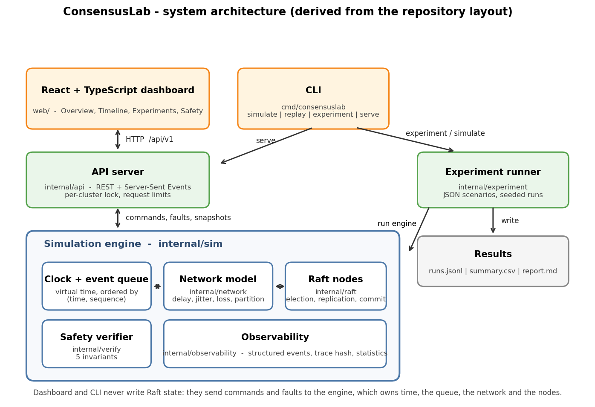
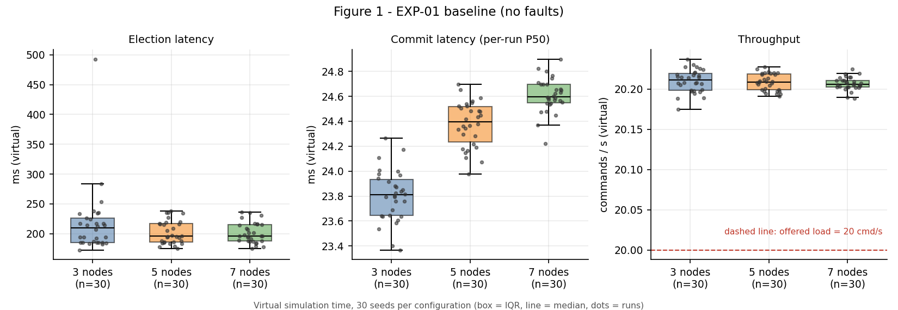
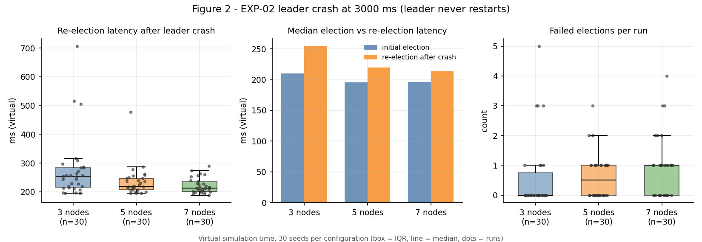
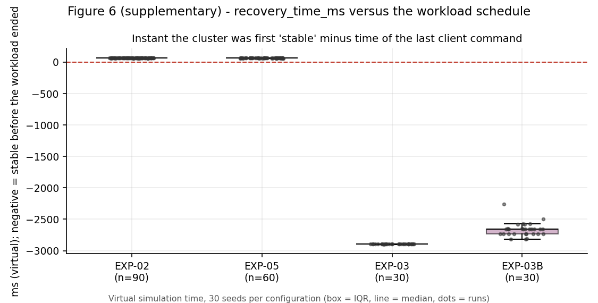
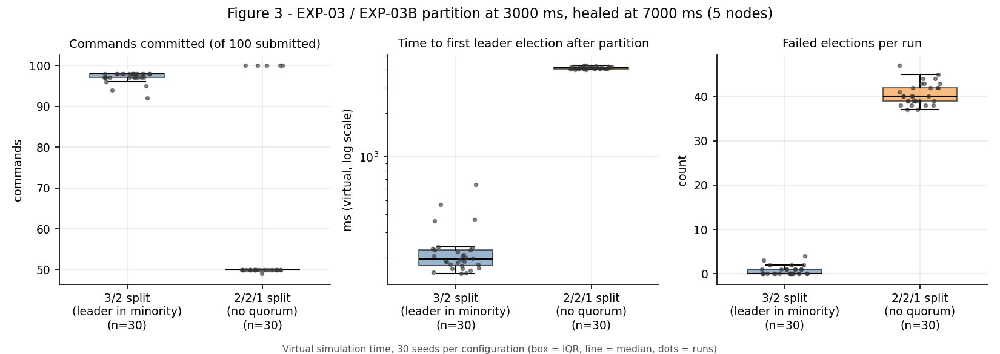
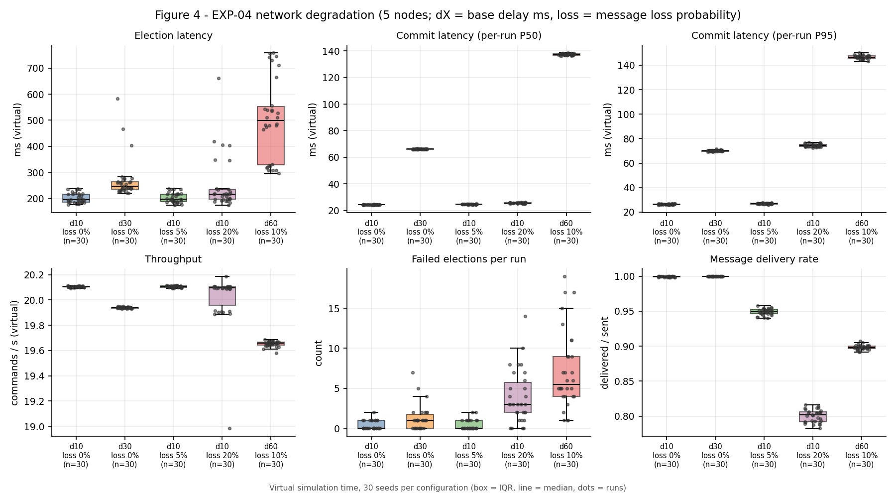
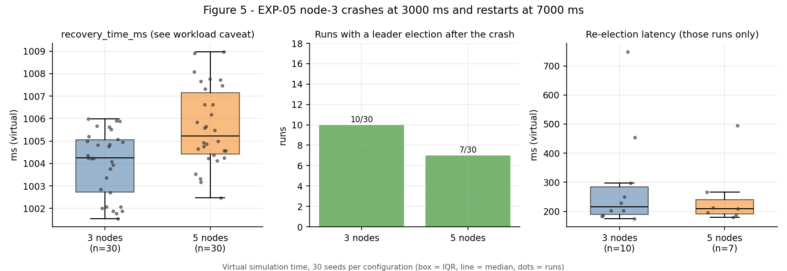

# ConsensusLab — Experimental Report

*Version 1.0 · 2 November 2026 · all numbers in this report are read from `results/runs/` and recomputed by `scripts/analyze_results.py`.*

## 1. Abstract

Distributed consensus protocols such as Raft are easy to describe and hard to observe: their interesting behaviour appears only under delays, message loss, crashes and partitions. ConsensusLab is a Go simulator that runs a Raft implementation on deterministic virtual time, injects those faults from seeded, reproducible scenarios, and checks five safety invariants after every event that changes a node. This report documents six experiments (EXP-01 to EXP-05, plus EXP-03B) that comprise 450 runs with 30 seeds per configuration, covering cluster sizes of 3, 5 and 7 nodes, a leader crash, two kinds of network partition, five network-degradation levels and a node restart. All 450 runs completed and the verifier reported 0 safety violations. Measured behaviour matches the expected Raft behaviour: elections complete in roughly 200 virtual ms, commit latency tracks one network round trip, a partition without a quorum elects no leader until it is healed, and 20% message loss nearly triples tail commit latency while leaving the median almost unchanged. The experiments also exposed limits of our own methodology: the `recovery_time_ms` metric in EXP-02 and EXP-05 is dominated by the end of the client workload, throughput saturates at the offered load, and EXP-05 mixes leader-crash and follower-crash runs. We report these as findings, not as results. All times are virtual simulation time; zero violations is empirical evidence for the tested scenarios, not a proof of correctness.

## 2. Introduction

### 2.1 Background

A distributed system is a set of independent processes that communicate only by messages and must keep working when some of them crash or when the network delays, loses or partitions messages. A replicated state machine keeps several copies of the same state; consensus is the problem of making those copies agree on the order of commands even though individual nodes and links fail. Raft solves it with a single elected leader per term, a replicated log and a rule that an entry is committed only when a majority stores it.

### 2.2 Problem statement

Reading the Raft paper does not show how election time, commit latency or availability change when conditions get worse, and testing a real cluster is slow, hard to reproduce and hard to debug. A simulator can replay the same failure exactly, vary one factor at a time and check invariants continuously. The problem addressed here is to build such an environment and use it to measure a Raft implementation under controlled faults, while being explicit about what the measurements do and do not show.

### 2.3 Project objectives

1. Implement Raft (leader election, log replication, commit rules, crash/restart) with fixed membership.
2. Run it on deterministic virtual time with injectable delay, jitter, message loss, partitions and node crashes.
3. Verify safety invariants continuously and independently of the Raft code.
4. Run reproducible, seeded experiments and report only measured values.
5. Make state observable through an event stream and an interactive dashboard.

### 2.4 Research questions

| ID | Question | Experiment |
|---|---|---|
| RQ1 | How does cluster size affect consensus performance? | EXP-01 |
| RQ2 | How does leader failure affect leadership recovery? | EXP-02 |
| RQ3 | How does network partitioning affect quorum availability? | EXP-03, EXP-03B |
| RQ4 | How do network delay and message loss affect performance? | EXP-04 |
| RQ5 | How does node restart affect recovery behaviour? | EXP-05 |

Reproducibility (same seed, same trace) is checked across all experiments in §6.7. These questions are formulated before the data analysis; the answers are in §8.

### 2.5 Contributions

* A deterministic Raft simulator with seeded fault injection, a replay command and a trace hash.
* An independent verifier for election safety, log matching, leader completeness, state-machine safety and index bounds.
* An experiment runner that writes JSONL, CSV and Markdown and never fills unmeasured values with zero.
* 450 verified runs, a data-verification step, and an analysis that separates findings from artefacts of the measurement method.
* A REST/SSE API and a React dashboard for interactive exploration.

## 3. System Architecture



The diagram is drawn from the repository layout by `scripts/make_architecture_diagram.py`.

| Component | Package | Responsibility |
|---|---|---|
| Raft engine | `internal/raft` | One node's protocol logic: roles, terms, votes, log, commit, key-value state machine. No sockets, no clock, no network randomness. |
| Simulation engine | `internal/sim` | Virtual clock, ordered event queue, node lifecycle (crash/restart), client commands, fault events, metrics. Single goroutine. |
| Network model | `internal/network` | Decides delay, jitter, loss and reachability of every message; counts outcomes. |
| Event queue | `internal/sim` | Min-heap ordered by (virtual time, sequence number); equal timestamps are processed in a fixed order. |
| Safety verifier | `internal/verify` | Reads node snapshots after each event; reports violations. |
| Observability | `internal/observability` | Structured events, bounded recorder, trace hash, summary statistics. |
| Experiment runner | `internal/experiment` | JSON scenarios, seeded runs, aggregation, `runs.jsonl` / `summary.csv` / `report.md`. |
| API | `internal/api` | REST and Server-Sent Events; per-cluster locking; request limits. |
| Dashboard | `web/` | React + TypeScript client; read-only snapshots plus commands and faults. |

Message flow: a node calls `Send`; the engine asks the network model for a decision (drop, or deliver after a delay) and schedules a delivery event; the engine pops the earliest event, calls the target node and then runs the verifier on that node. Because only the engine advances time and only seeded random generators are used, a run is a pure function of configuration, seed and inputs.

## 4. Raft Implementation

The implementation follows Figure 2 of the Raft paper with fixed membership. The points below describe what ConsensusLab does, including choices that differ from the minimal algorithm.

* **Election.** Followers and candidates keep an election deadline drawn from [min, max] with the node's own seeded generator. On expiry the node increments its term, votes for itself and sends `RequestVote`. A vote is granted only if the term matches after adopting any newer term, the node has not voted for someone else in that term, and the candidate's log is at least as up to date (higher last term, or equal last term and not shorter). The deadline is reset only when a vote is granted or an `AppendEntries` from a current-term leader is accepted, not on every message.
* **Leader start-up and no-op.** A new leader initialises `nextIndex` and `matchIndex` and appends a `NOOP` entry of its own term, which lets it commit entries from earlier terms indirectly.
* **Replication and fast backtracking.** `AppendEntries` carries `prevLogIndex`/`prevLogTerm`, up to 64 entries and the leader's commit index. A rejection returns `ConflictIndex` and `ConflictTerm`, so the leader skips a whole conflicting term instead of one index per round trip. A follower deletes an entry and its successors only when an incoming entry has the same index but a different term, so a delayed duplicate cannot truncate matching entries.
* **Current-term commit rule.** The leader advances `commitIndex` to the highest index stored on a quorum **and** belonging to its current term. Followers set `commitIndex = min(leaderCommit, last new entry)`.
* **State machine.** A deterministic key-value store applies committed `SET` and `DELETE` commands; `NOOP` changes nothing. A digest of the state is compared between nodes.
* **Crash and restart.** A crash stops ticks and drops messages to the node. A restart keeps `currentTerm`, `votedFor` and the log, and resets role, commit index, last applied index and the state machine.
* **Clients.** A client command addressed to "the leader" is sent to the highest-term leader that is up; if none exists it is retried every 20 virtual ms until it is accepted. Commit latency is measured from the moment a leader appends the command, so waiting time before acceptance is not included.

## 5. Experimental Methodology

### 5.1 Environment

| Item | Value |
|---|---|
| Operating system | Windows 11 |
| Go | 1.27.3 (module declares `go 1.22`) |
| Architecture | AMD64, 8 CPUs, about 8.3 GB RAM |
| Code version recorded in the runs | `dev` (no tagged build) |

This is the machine on which the experiments were run, not a minimum requirement. Because time is virtual, host speed affects only how long a run takes, not its results. The worker count used for the runs was not recorded; by design it does not change results (covered by the test `TestRunAllIsIndependentOfWorkerCount`).

### 5.2 Design

| Experiment | Name | Node counts | Variants | Seeds | Configured runs | Completed | Safety violations | Duration (virtual ms) | Faults | Workload (offered load) |
|---|---|---|---:|---:|---:|---:|---:|---:|---|---|
| EXP-01 | Baseline | 3, 5, 7 | 1 | 30 | 90 | 90 | 0 | 8000 | none | 50 @ 50 ms (20.00 cmd/s) |
| EXP-02 | Leader crash | 3, 5, 7 | 1 | 30 | 90 | 90 | 0 | 10000 | crash_leader@3000ms | 100 @ 50 ms (20.00 cmd/s) |
| EXP-03 | Network partition (3/2, leader in minority) | 5 | 1 | 30 | 30 | 30 | 0 | 12000 | partition@3000ms; heal@7000ms | 100 @ 80 ms (12.50 cmd/s) |
| EXP-03B | No quorum (2/2/1) | 5 | 1 | 30 | 30 | 30 | 0 | 12000 | partition@3000ms; heal@7000ms | 100 @ 80 ms (12.50 cmd/s) |
| EXP-04 | Network degradation | 5 | 5 | 30 | 150 | 150 | 0 | 15000 | none | 100 @ 50 ms (20.00 cmd/s) |
| EXP-05 | Restart recovery | 3, 5 | 1 | 30 | 60 | 60 | 0 | 12000 | crash@3000ms | 100 @ 60 ms (16.67 cmd/s) |
| **Total** | | | | | **450** | **450** | **0** | | | |

* **Seeds.** Seeds 1–30 for every configuration. A node's random generator is seeded with `seed XOR FNV-1a(node id)` and the network's with `seed XOR constant`, so every node and the network have independent but reproducible streams.
* **Timing parameters.** Election timeout uniform in 150–300 ms, heartbeat 50 ms, simulation tick 10 ms, message delay 10 ms plus uniform jitter 0–5 ms unless stated (EXP-04 varies them).
* **Fault injection.** `crash_leader` crashes whoever is leader at that instant; `crash` crashes a named node; `partition` splits the cluster into groups of the given sizes (`isolate_leader` puts the leader in the last group); `heal` removes the partition.
* **Workload.** Client commands `SET key-i value-i` at a fixed interval. The **offered load** is therefore 20.0 cmd/s in EXP-01, EXP-02 and EXP-04, 12.5 cmd/s in EXP-03 and EXP-03B and 16.67 cmd/s in EXP-05.
* **Warm-up.** The workload starts after the first election has normally completed (2000 ms, or 3000 ms in EXP-04).
* **The dashboard is not part of these data.** The 5-run experiment and the verifier counts shown in the dashboard screenshots are separate sessions; the 450 runs below come from the CLI.

### 5.3 Metrics (as implemented)

| Metric | Definition |
|---|---|
| `election_latency_ms` | Virtual time of the first `LeaderElected` event. |
| `reelection_latency_ms` | First `LeaderElected` after the first scheduled fault, minus the fault time; empty if no election followed. |
| `commit_latency_ms_p50/p95/p99` | Per run, over its committed commands: leader-append time to commit time. P95 needs ≥ 20 commands, P99 ≥ 100. |
| `throughput_commands_per_second` | Committed commands ÷ (last commit − first accepted command). |
| `recovery_time_ms` | From fault removal (restart or heal; the crash itself for a permanent crash) until the cluster is *stable*: no partition, quorum up, one leader that has committed an entry of its term, every up node with the same term, log length and commit index. |
| `failed_elections` | Elections started minus distinct terms that produced a leader. |
| `message_delivery_rate` | Messages delivered ÷ messages sent. |

In `summary.csv` and in the tables below, statistics are taken **across the 30 runs** of a configuration, so `commit_latency_ms_p50` there is the distribution of per-run medians, not a percentile over all commit events.

### 5.4 Statistics and verification

Tables give the median and, in parentheses, mean ± sample standard deviation across seeds; `summary.csv` also holds minimum, maximum, P95 (≥ 20 runs), P99 (≥ 100 runs) and a 95% confidence-interval half-width (Student t). Median and mean are reported side by side because a few runs can be much slower than the rest. Safety is checked after every event by the verifier (§7). Before analysis, `scripts/analyze_results.py` recomputed every statistic in the six `summary.csv` files from `runs.jsonl`: 450 of 450 configured runs are present and unique, all have status `ok`, and 728 compared values showed 0 mismatches (`results/analysis/data-verification.md`).

## 6. Experimental Results

Each table shows `median (mean ± SD)` over 30 seeds unless noted. Figures use the same data, with each dot being one run.

### 6.1 Baseline Performance (EXP-01)

**Goal.** Measure election and commit behaviour without faults for 3, 5 and 7 nodes (RQ1). **Configuration.** 90 runs, 8000 ms, 50 commands at 50 ms intervals, delay 10 ms + 0–5 ms jitter, no loss.

| Configuration | Election latency (ms) | Commit latency, per-run P50 (ms) | Commit latency, per-run P95 (ms) |
|---|---:|---:|---:|
| 3 nodes | 209.7 (217.8 ± 57.8) | 23.8 (23.8 ± 0.2) | 26.5 (26.5 ± 0.5) |
| 5 nodes | 195.8 (202.6 ± 19.3) | 24.4 (24.4 ± 0.2) | 26.3 (26.4 ± 0.4) |
| 7 nodes | 196.2 (201.2 ± 17.3) | 24.6 (24.6 ± 0.1) | 26.3 (26.3 ± 0.3) |

| Configuration | Commands committed, median [min–max] | Throughput (cmd/s) | Failed elections per run | Message delivery rate |
|---|---:|---:|---:|---:|
| 3 nodes | 50 [50–50] | 20.21 (20.21 ± 0.01) | 0.00 (0.33 ± 0.66) | 1.000 (0.999 ± 0.002) |
| 5 nodes | 50 [50–50] | 20.21 (20.21 ± 0.01) | 0.00 (0.37 ± 0.56) | 1.000 (0.999 ± 0.001) |
| 7 nodes | 50 [50–50] | 20.21 (20.21 ± 0.01) | 0.00 (0.50 ± 0.57) | 1.000 (0.999 ± 0.001) |



**Observations.**

* All 50 commands were committed in every run. No loss was configured, yet the mean delivery rate is 0.999: a few messages per run were not delivered, presumably because they were still in flight when the run ended (the per-run counts of sent and delivered messages are in `runs.jsonl`; we did not trace them individually).
* Median election latency was 209.7, 195.8 and 196.2 ms for 3, 5 and 7 nodes. The 3-node mean (217.8 ms) is pulled above its median by one slow run (493.0 ms) and its standard deviation (57.8 ms) is about three times that of the larger clusters (19.3 and 17.3 ms).
* Per-run median commit latency rose slightly with cluster size: 23.80, 24.38 and 24.61 ms (95% CI half-widths 0.08, 0.07 and 0.05 ms). The intervals do not overlap, so the increase of roughly 0.8 ms (3%) between 3 and 7 nodes is distinguishable from seed-to-seed noise, though it is small.
* Throughput was 20.21 cmd/s in all three sizes. This is the offered load (20 cmd/s) rather than a capacity limit; the measured value is about 1% above 20 because the window is measured between the first accepted command and the last commit (49 intervals for 50 commands). This experiment cannot say how many commands per second the system could handle.

### 6.2 Leader Crash Recovery (EXP-02)

**Goal.** Measure how fast a new leader emerges after the leader crashes (RQ2). **Configuration.** 90 runs, 10 000 ms, leader crashes at 3000 ms and never returns, 100 commands at 50 ms intervals.

| Configuration | Election latency (ms) | First election after fault (ms) | Commit latency, per-run P50 (ms) | Commit latency, per-run P95 (ms) |
|---|---:|---:|---:|---:|
| 3 nodes | 209.7 (217.8 ± 57.8) | 254.0 (277.8 ± 110.9) | 24.7 (24.7 ± 0.3) | 28.4 (28.4 ± 0.4) |
| 5 nodes | 195.8 (202.6 ± 19.3) | 219.4 (234.9 ± 52.2) | 24.8 (24.8 ± 0.1) | 27.5 (27.4 ± 0.4) |
| 7 nodes | 196.2 (201.2 ± 17.3) | 213.3 (221.6 ± 26.5) | 24.9 (24.9 ± 0.1) | 26.8 (26.8 ± 0.2) |

| Configuration | Commands committed, median [min–max] | Throughput (cmd/s) | Failed elections per run | Message delivery rate | recovery_time_ms (see §6.2 caveat) |
|---|---:|---:|---:|---:|---:|
| 3 nodes | 100 [100–100] | 20.10 (20.10 ± 0.01) | 0.00 (0.60 ± 1.25) | 0.787 (0.787 ± 0.003) | 4013.6 (4013.6 ± 1.7) |
| 5 nodes | 100 [100–100] | 20.10 (20.10 ± 0.01) | 0.50 (0.63 ± 0.76) | 0.903 (0.903 ± 0.001) | 4015.3 (4015.4 ± 1.4) |
| 7 nodes | 100 [100–100] | 20.10 (20.10 ± 0.00) | 1.00 (1.00 ± 1.02) | 0.937 (0.937 ± 0.001) | 4017.1 (4017.2 ± 2.1) |



**Observations.**

* A new leader was elected in every run. Median re-election latency (time from the crash to the next `LeaderElected`) was 254.0, 219.4 and 213.3 ms for 3, 5 and 7 nodes. Spread shrinks with cluster size (standard deviation 110.9, 52.2, 26.5 ms); the slowest 3-node run took 706.8 ms.
* All 100 commands were committed in all 90 runs: the client keeps retrying while no leader exists. The outage is therefore visible in `reelection_latency_ms` but **not** in commit latency, which starts when a leader accepts the command (per-run P95 about 27.5 ms).
* **`recovery_time_ms` is not an intrinsic recovery duration here.** Its median is about 4014–4017 ms in all three sizes, but the cluster was first "stable" only 60–71 ms after the *last client command* in every one of the 90 runs (`results/analysis/workload-artifact-check.csv`, Figure 6). The stability condition requires every up node to have the same commit index and log length; with commands arriving every 50 ms, equal to the heartbeat interval, followers learn the new commit index only with the next message, so the condition was met only once the workload stopped. Treat these values as a property of the workload schedule. A meaningful recovery time needs a quiet period or a different stability definition (see §9).
* The initial election in EXP-02 is identical to EXP-01 for the same seeds (see §6.7), so the difference between the initial and the post-crash election is not due to different random draws.



### 6.3 Network Partition with the Leader in the Minority (EXP-03)

**Goal.** Check that the majority side continues, the isolated leader cannot commit and logs converge after healing (RQ3). **Configuration.** 30 runs, 5 nodes, split 3/2 with the leader in the 2-node group at 3000 ms, healed at 7000 ms, 100 commands at 80 ms intervals.

| Configuration | Election latency (ms) | First election after fault (ms) | Commit latency, per-run P50 (ms) | Commit latency, per-run P95 (ms) |
|---|---:|---:|---:|---:|
| 5 nodes, 3/2 split (leader in the minority) | 195.8 (202.6 ± 19.3) | 195.7 (228.2 ± 103.5) | 25.1 (25.0 ± 0.2) | 28.2 (28.2 ± 0.4) |

| Configuration | Commands committed, median [min–max] | Throughput (cmd/s) | Failed elections per run | Message delivery rate | recovery_time_ms (see §6.2 caveat) |
|---|---:|---:|---:|---:|---:|
| 5 nodes, 3/2 split (leader in the minority) | 98 [92–98] | 12.33 (12.23 ± 0.17) | 0.00 (0.70 ± 1.02) | 0.823 (0.823 ± 0.003) | 25.6 (25.6 ± 1.7) |

**Observations.**

* The 3-node majority elected a new leader a median of 195.7 ms after the partition (mean 228.2, maximum 639.0 ms).
* 98 of 100 commands were committed at the median (range 92–98). The `runs.jsonl` records do not separate "lost" from "never committed", but the shortfall is consistent with commands accepted by the isolated old leader during the window before the new leader existed and discarded after healing: across the 30 runs, the number of uncommitted commands correlates with the re-election latency (Pearson r = 0.98), and its mean (2.83) is close to the mean re-election latency divided by the 80 ms command interval (2.85).
* The cluster was stable again a median of 25.6 ms after the heal (range 22.0–27.9 ms), long before the workload ended, so this metric is not affected by the artefact described in §6.2.
* Throughput (about 12.2 cmd/s) equals the offered load of this experiment (12.5 cmd/s) and must not be compared with the 20 cmd/s of EXP-01.

### 6.4 No-Quorum Behaviour (EXP-03B)

**Goal.** Observe a partition in which no group has a quorum (RQ3). **Configuration.** 30 runs, 5 nodes, split 2/2/1 at 3000 ms, healed at 7000 ms, 100 commands at 80 ms intervals.

| Configuration | Election latency (ms) | First election after fault (ms) | Commit latency, per-run P50 (ms) | Commit latency, per-run P95 (ms) |
|---|---:|---:|---:|---:|
| 5 nodes, 2/2/1 split | 195.8 (202.6 ± 19.3) | 4151.9 (4139.8 ± 78.2) | 24.4 (50.5 ± 60.0) | 26.5 (673.4 ± 1445.7) |

| Configuration | Commands committed, median [min–max] | Throughput (cmd/s) | Failed elections per run | Message delivery rate | recovery_time_ms (see §6.2 caveat) |
|---|---:|---:|---:|---:|---:|
| 5 nodes, 2/2/1 split | 50 [49–100] | 6.29 (7.34 ± 2.39) | 40.00 (40.57 ± 2.50) | 0.799 (0.792 ± 0.019) | 264.1 (254.8 ± 108.4) |



**Observations.**

* No leader was elected during the partition: the first election after the fault happened 4027.0–4288.0 ms after it began, i.e. after the heal at +4000 ms, in all 30 runs.
* Isolated groups kept starting elections that could not succeed: 40.0 failed elections per run at the median (range 37–47), compared with 0.0 in EXP-03.
* Commits show two groups of runs: 25 runs committed 49–50 commands and 5 runs committed all 100. In the 5 runs that committed everything, the median commit latency was 158–208 ms and per-run P99 about 4.1–4.2 s, i.e. commands accepted before the heal were committed after it. The aggregate mean of per-run P50 (50.5 ms) is therefore very different from its median (24.4 ms). The `runs.jsonl` data do not show why these 5 runs differ; per-run event traces (`consensuslab simulate -events`) would be needed. We make no claim about the cause.
* Safety held in all 30 runs; not committing during the partition is the expected behaviour of a system that prefers consistency.

### 6.5 Network Degradation (EXP-04)

**Goal.** Measure the effect of delay, jitter and loss (RQ4). **Configuration.** 150 runs, 5 nodes, five network variants, 100 commands at 50 ms intervals starting at 3000 ms, no crashes.

| Configuration | Election latency (ms) | Commit latency, per-run P50 (ms) | Commit latency, per-run P95 (ms) |
|---|---:|---:|---:|
| delay10-loss0: 10 ms + 0–5 ms jitter, 0% loss | 195.8 (202.6 ± 19.3) | 24.4 (24.4 ± 0.2) | 26.4 (26.4 ± 0.3) |
| delay30-loss0: 30 ms + 0–10 ms jitter, 0% loss | 247.9 (271.4 ± 77.9) | 66.2 (66.2 ± 0.2) | 69.9 (70.0 ± 0.5) |
| delay10-loss5: 10 ms + 0–5 ms jitter, 5% loss | 197.4 (203.2 ± 19.0) | 24.6 (24.6 ± 0.2) | 26.9 (26.9 ± 0.4) |
| delay10-loss20: 10 ms + 0–5 ms jitter, 20% loss | 216.3 (251.5 ± 104.4) | 25.5 (25.5 ± 0.3) | 74.7 (74.7 ± 1.2) |
| delay60-loss10: 60 ms + 0–20 ms jitter, 10% loss | 498.2 (502.4 ± 154.8) | 137.4 (137.4 ± 0.6) | 146.6 (146.5 ± 1.5) |

| Configuration | Commands committed, median [min–max] | Throughput (cmd/s) | Failed elections per run | Message delivery rate |
|---|---:|---:|---:|---:|
| delay10-loss0: 10 ms + 0–5 ms jitter, 0% loss | 100 [100–100] | 20.11 (20.11 ± 0.00) | 0.00 (0.37 ± 0.56) | 1.000 (1.000 ± 0.001) |
| delay30-loss0: 30 ms + 0–10 ms jitter, 0% loss | 100 [100–100] | 19.94 (19.94 ± 0.01) | 1.00 (1.27 ± 1.60) | 1.000 (1.000 ± 0.000) |
| delay10-loss5: 10 ms + 0–5 ms jitter, 5% loss | 100 [100–100] | 20.11 (20.10 ± 0.01) | 0.00 (0.40 ± 0.62) | 0.949 (0.949 ± 0.005) |
| delay10-loss20: 10 ms + 0–5 ms jitter, 20% loss | 100 [99–100] | 20.09 (20.02 ± 0.21) | 3.00 (3.90 ± 3.35) | 0.802 (0.800 ± 0.009) |
| delay60-loss10: 60 ms + 0–20 ms jitter, 10% loss | 100 [100–100] | 19.66 (19.65 ± 0.02) | 5.50 (7.23 ± 4.90) | 0.898 (0.899 ± 0.003) |



**Observations.**

* Median commit latency follows the round trip: 24.4, 66.2 and 137.4 ms for one-way delays of 10, 30 and 60 ms (plus jitter up to 5, 10 and 20 ms). A back-of-envelope estimate of 2 × (delay + jitter/2) gives 25, 70 and 140 ms; the observed values are slightly lower, as expected when the leader needs only the fastest quorum of replies.
* Loss barely moves the median but strongly affects the tail. At 20% loss the per-run median is 25.54 ms against 24.37 ms without loss, whereas the per-run P95 is 74.7 ms against 26.4 ms. The increase of about 48 ms is close to the 50 ms heartbeat interval, which fits the explanation that a lost message is repaired by the next heartbeat. At 5% loss the P95 is unchanged (26.9 ms).
* Election gets slower and less predictable under worse conditions: median 195.8 ms (baseline), 247.9 ms (30 ms), 216.3 ms (20% loss, mean 251.5 ms, maximum 661.3 ms) and 498.2 ms (60 ms, 10% loss). Failed elections per run rise from a mean of 0.37 to 3.90 (20% loss) and 7.23 (60 ms, 10% loss). When the round trip (about 140 ms in the last variant) approaches the election timeout (150–300 ms), candidates often collect votes too late.
* All 100 commands were committed in every run except four runs at 20% loss, which committed 99 each. Throughput stays close to the offered load; the decline to 19.66 cmd/s at 60 ms is what the metric definition predicts from the longer last-commit latency (100 ÷ (4.95 s + 0.137 s) ≈ 19.66), not evidence of lost capacity. No capacity limit was reached in this experiment.

### 6.6 Restart Recovery (EXP-05)

**Goal.** Observe the effect of a node crash and restart (RQ5). **Configuration.** 60 runs, 3 and 5 nodes, `node-3` crashes at 3000 ms and restarts at 7000 ms, 100 commands at 60 ms intervals.

| Configuration | Election latency (ms) | First election after fault (ms) | Commit latency, per-run P50 (ms) | Commit latency, per-run P95 (ms) |
|---|---:|---:|---:|---:|
| 3 nodes | 209.7 (217.8 ± 57.8) | 216.1 (292.7 ± 180.6) [10/30 runs] | 24.5 (24.5 ± 0.3) | 28.1 (28.0 ± 0.4) |
| 5 nodes | 195.8 (202.6 ± 19.3) | 209.7 (249.4 ± 112.0) [7/30 runs] | 24.8 (24.8 ± 0.2) | 27.1 (27.1 ± 0.4) |

| Configuration | Commands committed, median [min–max] | Throughput (cmd/s) | Failed elections per run | Message delivery rate | recovery_time_ms (see §6.2 caveat) |
|---|---:|---:|---:|---:|---:|
| 3 nodes | 100 [100–100] | 16.77 (16.77 ± 0.00) | 0.00 (0.53 ± 0.97) | 0.903 (0.903 ± 0.001) | 1004.2 (1004.0 ± 1.4) |
| 5 nodes | 100 [100–100] | 16.77 (16.77 ± 0.00) | 0.00 (0.57 ± 0.86) | 0.955 (0.955 ± 0.000) | 1005.2 (1005.6 ± 1.7) |



**Observations.**

* All 100 commands were committed in all 60 runs, so the cluster kept committing while `node-3` was down and after it returned.
* The experiment was intended as a follower crash, but `node-3` is not always a follower. A leader election followed the crash in 10 of 30 runs (3 nodes) and 7 of 30 runs (5 nodes), which is close to 1 in n; these runs are leader crashes. EXP-05 therefore mixes two situations, and its re-election statistics describe only the runs where the crashed node happened to be the leader.
* `recovery_time_ms` is about 1004–1006 ms. As in EXP-02, the first stable instant was 62–69 ms after the last client command in all 60 runs, so the value reflects the workload schedule. The data show that the restarted node was consistent with the rest of the cluster (same log length and commit index) at the first stable instant in 60 of 60 runs, but not how quickly it caught up. The medians for runs with and without a leader election are indistinguishable (1004.2 versus 1004.3 ms for 3 nodes, 1006.6 versus 1005.0 ms for 5 nodes), as expected if the workload dominates.

### 6.7 Reproducibility

* All 450 runs have distinct trace hashes, as they should: every combination of configuration and seed is different.
* For the same cluster size and seed, `election_latency_ms` is bit-for-bit identical across experiments (EXP-02 and EXP-05 against EXP-01 in 150 of 150 runs; EXP-03, EXP-03B and the no-loss variant of EXP-04 against the 5-node EXP-01 runs in 30 of 30 each). This is the expected behaviour of a deterministic simulator: the first election happens before any fault or difference in network settings.
* `consensuslab replay` for the smoke scenario (3 nodes, seed 1) printed the same trace hash twice (`e65ec8d8…f1cf`) and reported that two runs produced identical traces.

## 7. Safety and Verification

| Invariant | Meaning | How it is checked |
|---|---|---|
| Election safety | At most one leader per term | The first leader seen in each term is recorded; a different leader in the same term is a violation. |
| Log matching | Equal (index, term) in two logs implies identical prefixes | Pairwise comparison of all logs every 50 events and at the end of the run. |
| Leader completeness | A leader of term T holds every entry committed in an earlier term | Checked when a leader of a term is first observed. |
| State machine safety | No two nodes commit or apply different entries at the same index | Global map index → entry; equal `lastApplied` must give equal state digests. |
| Index bounds | `lastApplied ≤ commitIndex ≤ lastLogIndex`; entry index equals its position; terms do not decrease at the tail | After every event touching a node. |

| Evidence | Scope | Result |
|---|---|---|
| Verifier in the 450 experiment runs | All six experiments | 0 violations in 450 of 450 runs |
| Unit, integration (INT-01…12) and randomized tests | `go test -count=1 ./...` on the author's machine | all listed packages reported `ok` (see `docs/images/terminal-tests.png`) |
| One dashboard session | 5 nodes, seed 42 | status `passed`, 5 invariants, 100 854 observations (see `docs/images/safety-verification.png`) |
| Replay self-check | smoke scenario, seed 1 | identical trace hash in two runs |

The observation count in the dashboard belongs to that single interactive session; the experiment records store the number of violations but not the number of observations. The Go race detector was **not** run, because the environment lacked CGO, so no claim about it is made. A clean verifier report means that no violation was observed in the executed scenarios; it is not a proof of correctness for all executions.

## 8. Discussion

**RQ1 — cluster size.** Election latency changed little with size once the cluster had three nodes (medians 209.7, 195.8, 196.2 ms); the main difference was spread: the 3-node case had the largest variance and the slowest run. A rough expectation supports the level: the earliest of N uniform timeouts on 150–300 ms is 150 + 150/(N+1) = 187.5, 175.0 and 168.8 ms for N = 3, 5, 7; adding about one message round trip (~25 ms) gives roughly 212, 200 and 194 ms, the same order as the observed medians. This is reasoning about expected values, not a fitted model. Commit latency grew by about 3% from 3 to 7 nodes, consistent with the leader waiting for a larger quorum. Throughput showed no difference because the offered load, not the cluster, was the limit.

**RQ2 — leader failure.** Leadership was restored in every run within a median of 213.3–254.0 ms and at most 706.8 ms. The 3-node cluster was slower and more variable than the larger ones; we did not instrument why. A plausible reason is that with only two survivors a candidate needs the other survivor's vote, which is refused if its log is more up to date, but this is a hypothesis and was not tested. Client retries hid the outage completely from the commit-latency metric, so commit latency alone would understate the impact of a leader failure.

**RQ3 — partitions.** The experiments behave as Raft predicts. With a 3-node majority, a new leader appeared after a median of 195.7 ms and the cluster was stable shortly after healing; commands accepted by the isolated leader were not committed. With no quorum anywhere, no leader existed until the heal and each isolated group kept failing elections (about 40 per run). The bimodal EXP-03B commit outcomes (50 versus 100 commands) are an open question that needs per-run traces.

**RQ4 — delay and loss.** Median commit latency scales with the round trip. Loss mainly affects the tail, by about one heartbeat interval at 20% loss. Elections are the part of the protocol most sensitive to degradation: slower, more variable and with more failed attempts as the round trip approaches the election timeout. Throughput could not be stressed because the offered load was fixed at 12.5–20 cmd/s.

**RQ5 — restart.** The cluster kept committing during and after the follower outage and the restarted node was consistent at the first stable instant in all runs. The catch-up time itself was not measured, because `recovery_time_ms` was dominated by the workload, and a third of the runs in the 3-node case were leader crashes.

**Agreement with expected Raft behaviour.** No safety violation was found; partitions without a quorum did not elect a leader; commit latency tracked one round trip; the current-term commit rule and log repair never produced a divergent committed entry in the verifier's view. None of the results contradicts the expected behaviour.

**Findings to investigate or fix.**

1. `recovery_time_ms` should be re-measured with a quiet period after the fault (or a stability condition that tolerates in-flight commands); the EXP-02 and EXP-05 values should not be cited as recovery durations.
2. EXP-05 should pick a node that is not the leader at crash time, or be split into follower-crash and leader-crash variants.
3. Throughput experiments need an offered load above the capacity of the system; the present ones only show that the system keeps up with 12.5–20 cmd/s.
4. The two groups of runs in EXP-03B need per-run traces.
5. Commit latency starts at leader acceptance; a client-visible latency that includes waiting for a leader would better reflect availability.

## 9. Limitations and Future Work

**Limitations.**

* Fixed cluster membership, no snapshots or log compaction, and no disk persistence (state "survives" a simulated restart only in memory).
* No pre-vote and no check-quorum: a partitioned leader keeps accepting commands until it hears a higher term, which explains why commands are lost in EXP-03 and affects EXP-03B.
* Simulated, single-process, virtual-time execution; results are not predictions of real distributed deployments, and virtual times must not be compared with wall-clock measurements.
* Results depend on the network model (independent loss, uniform jitter, clean partitions), the timing parameters and the 30 seeds per configuration. Seeds 1–30 are consecutive integers; they are not a random sample of all possible executions.
* Single run per configuration set on one machine; no repetition of the whole batch and no comparison with another implementation.
* Metric caveats described in §6: commit latency excludes waiting for a leader; throughput is bounded by the offered load; `recovery_time_ms` is workload-dominated in EXP-02 and EXP-05.
* The verifier checks five invariants on observed states; it is not a model checker, and the race detector has not been run.

**Future work.** Re-run recovery measurements with a quiet period; add pre-vote and check-quorum and compare; persistent storage and snapshotting; dynamic membership; higher offered load for throughput; more adversarial fault schedules (asymmetric links, duplication, reordering); a TLA+ model or other model checking; a process-based cluster reported separately; and a comparison with another consensus implementation under identical scenarios.

## 10. Conclusion

ConsensusLab implements Raft with fixed membership on deterministic virtual time, injects crashes, partitions, delay and loss from seeded scenarios and verifies five invariants continuously. Across 450 runs in six experiments, all runs completed and the verifier reported 0 violations. The measured behaviour agrees with what Raft predicts: elections complete in about 200 virtual ms, a lost leader is replaced in a few hundred ms, commit latency follows the network round trip, loss inflates tail latency by about one heartbeat, and a partition without a quorum elects no leader until it heals. The analysis also found weaknesses in the measurement design, listed in §8, which should be fixed before any recovery-time or throughput claim is made. The results are empirical evidence for the tested scenarios, in virtual time, and not a proof of correctness.

## Appendix A — Reproducing the analysis

```bash
# experiments (from the repository root)
consensuslab experiment -config configs/exp-01-baseline.json -out results/runs/exp-01   # …and the other five
# verification, tables and figures
python scripts/analyze_results.py
# architecture diagram
python scripts/make_architecture_diagram.py
```

The analysis writes `results/analysis/experiment-overview.csv`, `metrics-comparison.csv`, `workload-artifact-check.csv`, `data-verification.md` and `figures/`. Copies of the figures used here are in `docs/figures/`.
